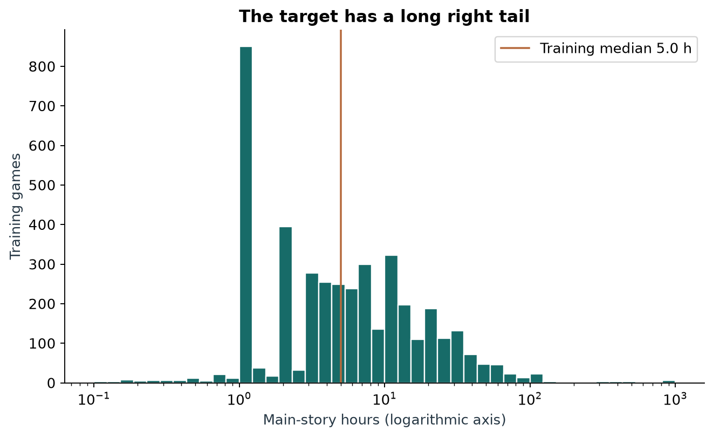
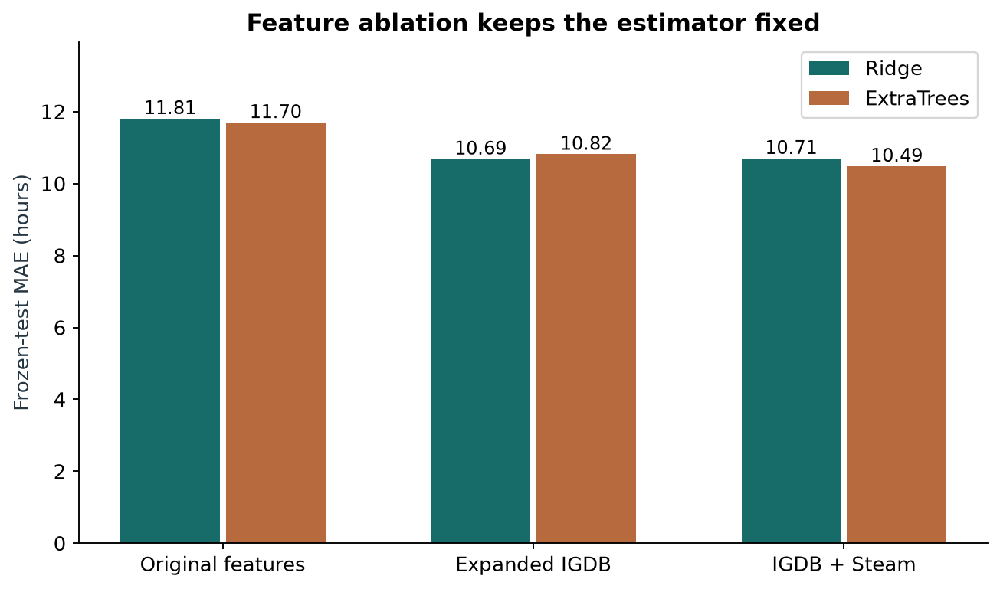
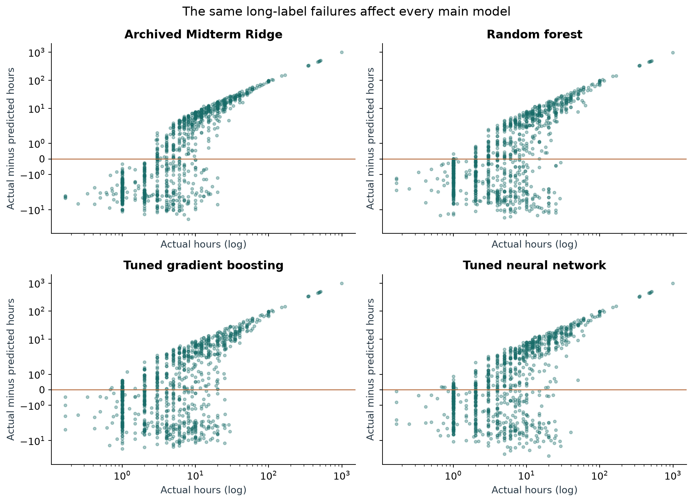
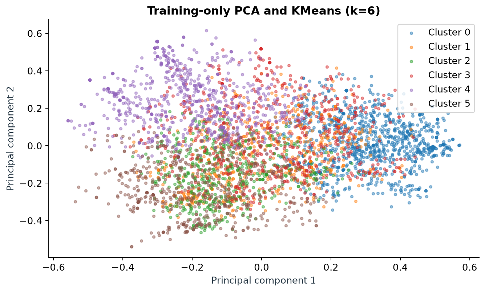
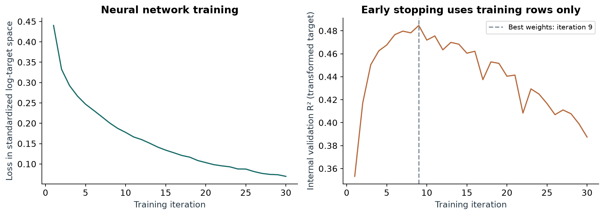

# Predicting video game completion time

Machine Learning Algorithms Endterm

Syrym Shadiyarbek and Yerdaulet Akhanov, SE2424

## Research question and answer

Can structured game metadata help a player choose a game that fits a time budget? We predict a positive number of main-story hours. On the same 1,046 test games as the Midterm, the model selected by training CV is Random forest, with MAE 10.37 hours, RMSE 50.54 hours, R2 0.022 and median absolute error 2.26 hours. The result supports rough catalog estimates, while large errors for long and open-ended games remain.

The gain against the exact submitted Midterm Ridge is 1.45 hours MAE, with a conditional paired 95% interval of 1.18 to 1.72 hours. Against the median dummy, MAE is 20.3% lower. These are measured stage comparisons on an already observed test, with the limitations explained below.

## Changes responding to the teacher

The teacher's feedback supplied from 2 November 2026 identified missing collection code and conclusions, empty columns, and the need to upload every file in a ZIP because GitHub would not be checked. It also commented on the defence ("защита получше"). The complete ZIP now contains collection code, raw responses, cleaned data, saved split, an executed notebook, model checks and outputs, the report and slides. The notebook displays collection source and ends with a computed conclusion. The final slide states the answer and next experiment. The seven-minute defence guide includes both speakers and five minutes of Q&A preparation.

The new data types are genuine observations on the same games. A short change log in docs/CHANGELOG.md links each feedback point to before/after evidence. Historical empty fields remain clearly identified audit columns and are excluded from predictors. Presentation and report build scripts are retained under tools/ so their construction is reproducible.

## Data, collection and cleaning

One row describes one of 5,229 real distinct games. The original target is IGDB game_time_to_beats.hastily seconds divided by 3,600, recorded on 8 October 2026: reaching credits without notable extras. The old raw field is named hltb_main_hours, but its recorded source is IGDB. No HLTB targets are mixed in.

Metadata collected on 2 November 2026 adds IGDB themes, gameplay keywords, modes, perspectives, platforms, engines and game type. Explicit linked Steam app IDs add tags, store categories, supported platforms/languages and current US USD prices. The saved snapshot contains 2,861 observed regular prices and 3,333 rows with Steam tags. Missing quotes remain missing. Prices describe current store listings and cannot support launch-day forecasting. All observed price fields and tag names are verified against saved raw responses. Timestamps, URLs, dictionaries and hash manifests accompany those responses.

src/collect.py contains the enrichment requests, batched requests/caching, bounded retries, explicit matching and environment-based credentials. reference/midterm_source/src/collect_igdb.py preserves the original target collector. Both files are inside the ZIP and visible from the notebook. Developer secrets are excluded. The saved IGDB API terms and Steam terms/robots checks document access. The IGDB website robots request returned 403, so collection used the official authenticated API. No private user profiles or individual reviews enter the data.

The supplied Midterm raw snapshot has 5,273 rows. Its inherited rules remove 28 durations below 0.1 hours, five descriptions with fewer than eight words, one title with fewer than two characters, and ten repeated normalized-title/year records, leaving 5,229 games. The target inclusion range is 0.1-1,000 hours. These short durations are real observations outside the inclusion rule, rather than demonstrated source errors. Text readiness and duplicate filters can also exclude real short games or different editions. The row-level cleaning audit reconstructs every decision. Endterm adds columns by left join and changes no games, targets or split assignments.

The main modelling dataset is data/clean/games_model_inputs.csv: 5,229 rows and 43 columns, consisting of 39 populated raw predictor fields plus game ID, title, target and saved partition for reference. No predictor is entirely empty. The data card and CSV dictionary also define the full 70-column provenance/audit view. IDs, titles, descriptions, source URLs, timestamps, other completion-time fields and explicit duration tags are excluded from predictors. Empty old price/tag fields remain audit-only. Numeric missing-value medians and missingness indicators enter the model pipeline without turning imputed values into observations.

## Exploration and modelling decisions

Three training-only summaries guide the choices below.

| Evidence | Interpretation | Decision |
| --- | --- | --- |
| Median duration 5 h, 95th percentile 40 h, 99th percentile 100 h | A small tail can dominate squared error. | Select by hour MAE, report RMSE/R2, and test log-target models. |
| RPG median 14.25 h over 246 training games; Indie 3 h over 374 | Broad genres carry information but conceal variation. | Add detailed themes, modes, perspectives and gameplay tags. |
| 2,305 observed training prices; Spearman price/duration correlation 0.618 | Price and duration vary together in the store-linked subset. | Test price jointly, report coverage and compare fixed-estimator feature sets. |

These associations do not establish causal effects. Selective Steam coverage and correlated predictors limit interpretations of price and tag importance.

## Fair workflow and tuning

The saved split is byte-identical to Midterm: 4,183 training and 1,046 test games. Every candidate uses the same three shuffled training folds with seed 42. Numeric imputation/scaling, one-hot encoding, multi-hot vocabularies and developer catalog-frequency tiers fit each training fold only. Catalog frequency is a proxy, not verified studio size. Twenty-three test rows share Steam app IDs with training. Grouped training CV and the test subset without overlap describe that limitation.

The median dummy provides the absolute-error baseline. OLS tests linear relationships; Ridge adds regularization; a depth-10 tree with at least ten rows per leaf limits tree complexity; 25-neighbour distance-weighted KNN tests local similarity with numeric scaling. Fixed Ridge and ExtraTrees configurations repeat across original, IGDB and IGDB-plus-Steam features. Full model settings and reasons are in outputs/model_specifications.csv.

Random forest searches n_estimators 150/250, minimum leaf rows 3/8 and feature fraction 0.5/0.7: eight configurations. Tree count checks averaging stability, minimum leaf size limits complexity, and feature fraction controls diversity. Boosting searches 15/31 leaves, 20/50 minimum leaf rows and L2 1/10, holding 250 iterations and learning rate 0.07 fixed. It fits absolute-error loss directly in hours. The MLP searches hidden layers (32,) or (64,32) and L2 0.01/0.1. These small networks and penalties control complexity for the available training sample.

| Search | Grid size | Selected parameters | CV MAE +/- SD |
| --- | --- | --- | --- |
| Random forest | 8 | {'max_features': 0.5, 'min_samples_leaf': 3, 'n_estimators': 250} | 8.636 +/- 0.642 |
| Boosting | 8 | {'l2_regularization': 10, 'max_leaf_nodes': 31, 'min_samples_leaf': 20} | 8.639 +/- 0.602 |
| MLP | 4 | {'alpha': 0.1, 'hidden_layer_sizes': [64, 32]} | 9.016 +/- 0.637 |

Each search uses training CV MAE with fold-fitted preprocessing. The winner is locked before test predictions. The selected CV score is a search estimate and can be optimistic because CV is not nested. OLS, Ridge, trees, KNN and forests fit log1p hours. The MLP standardizes that log target. Every reported metric uses inverse-transformed hour predictions. Exact archived Midterm predictions remain a separate historical reference; current original-feature rows are refits through the current pipeline.

## Results on the saved split

MAE is the primary metric because a player interprets error in hours and occasional long labels strongly affect squared error. CV spread is the sample standard deviation over three folds. All baseline and current model comparisons appear in one table.

| Model / features | CV MAE +/- SD | Test MAE | RMSE | R2 | Median AE |
| --- | --- | --- | --- | --- | --- |
| Median baseline | 11.075 +/- 0.716 | 13.01 | 52.17 | -0.041 | 4.00 |
| Linear regression original | 10.101 +/- 0.637 | 11.83 | 51.27 | -0.006 | 3.28 |
| Decision tree original | 10.192 +/- 0.801 | 11.81 | 50.96 | 0.006 | 3.26 |
| KNN original | 10.401 +/- 0.686 | 11.90 | 51.25 | -0.005 | 3.29 |
| Ridge original | 10.074 +/- 0.680 | 11.81 | 51.43 | -0.012 | 3.20 |
| Ridge IGDB | 9.254 +/- 0.656 | 10.69 | 50.36 | 0.029 | 2.55 |
| Ridge IGDB + Steam | 9.157 +/- 0.680 | 10.71 | 50.49 | 0.024 | 2.42 |
| ExtraTrees original | 10.014 +/- 0.665 | 11.70 | 51.12 | -0.000 | 3.39 |
| ExtraTrees IGDB | 9.222 +/- 0.695 | 10.82 | 50.53 | 0.023 | 2.50 |
| ExtraTrees IGDB + Steam | 8.772 +/- 0.743 | 10.49 | 50.54 | 0.022 | 2.37 |
| Random forest | 8.636 +/- 0.642 | 10.37 | 50.54 | 0.022 | 2.26 |
| Boosting | 8.639 +/- 0.602 | 10.26 | 50.52 | 0.023 | 2.39 |
| MLP | 9.016 +/- 0.637 | 10.41 | 50.18 | 0.036 | 2.29 |

The exact submitted Midterm Ridge test MAE was 11.81593 h. Its current original-feature refit is 11.81296 h; the small difference reflects the current encoding pipeline. Selection uses the new candidates' training CV, while the historical gain above uses the archived predictions. Steam-ID-grouped CV for the selected model is 8.64 +/- 0.69 h.

The top two expanded CV means differ by only 0.00348 h, compared with fold standard deviations around 0.64 h. The minimum-mean rule resolves this near-tie mechanically. It does not establish a meaningful advantage over the runner-up. A different test ranking does not change that predeclared training-CV selection.

## Value of the additional columns

With unchanged Ridge settings, IGDB fields move test MAE from 11.81 to 10.69 h, and adding Steam gives 10.71 h. With unchanged ExtraTrees settings, the corresponding values are 11.70, 10.82 and 10.49 h. Steam has model-dependent additional value after IGDB metadata. The paired intervals and a training-validation permutation check document uncertainty and correlated-feature effects.

Bootstrap resampling uses the same test games in pairs 5,000 times. It describes these fitted models on this cohort and does not cover all training variability or create a fresh independent test.

## Errors across models

The following table shows each principal model's test MAE by actual-duration band. Complete duration and genre tables cover all 13 current models plus the exact archived Ridge. Positive residual means underprediction.

| Model | 0-5 h | >5-20 h | >20-50 h | >50-100 h | >100 h |
| --- | --- | --- | --- | --- | --- |
| Median baseline | 2.71 | 5.97 | 26.47 | 68.9 | 382.3 |
| Archived Midterm Ridge | 2.65 | 5.01 | 20.5 | 64.39 | 378.39 |
| Random forest | 1.8 | 4.3 | 15.75 | 57.1 | 373.67 |
| Boosting | 1.91 | 4.14 | 14.7 | 57.29 | 373.86 |
| MLP | 1.78 | 4.6 | 15.53 | 57.36 | 369.99 |

The linear reference smooths coarse metadata relationships. Forests and boosting exploit nonlinear interactions, while the MLP learns a regularized transformed-target representation. The measured bands reveal where those mechanisms help and where every model underpredicts the long tail. Log-target fits favour relative distinctions and common short games. Raw-hour absolute-error boosting also favours conditional medians, so it does not resolve open-ended-game labels.

The lowest observed band errors among the two ensembles and MLP belong to MLP in the 0-5 h band (1.78 h MAE), Boosting in the >5-20 h band (4.14 h MAE), Boosting in the >20-50 h band (14.70 h MAE), MLP in the >100 h band (369.99 h MAE). Different models lead in different bands. These are descriptive test comparisons; they do not override the training-CV choice or establish statistically significant band-wise gains.

Linear regression original has MAE 2.64 h for 0-5-hour games and 20.29 h for >20-50-hour games. Decision tree original has MAE 2.86 h for 0-5-hour games and 19.17 h for >20-50-hour games. KNN original has MAE 2.70 h for 0-5-hour games and 19.56 h for >20-50-hour games. ExtraTrees IGDB + Steam has MAE 1.94 h for 0-5-hour games and 15.60 h for >20-50-hour games. The tree and neighbour references improve some medium-duration errors while retaining substantial short-game errors. Expanded ExtraTrees reduces both bands, but its long-tail failures remain visible in the complete duration table. The fixed-feature comparisons separate nonlinear interactions from the additional metadata.

Median baseline has MAE 2.71 h for 0-5-hour games and 382.30 h above 100 hours. Among 5-100-hour games, its largest error is Sonic Adventure: Sonic Adventure DX Upgrade: actual 100.00 h, predicted 5.00 h.

Archived Midterm Ridge has MAE 2.65 h for 0-5-hour games and 378.39 h above 100 hours. Among 5-100-hour games, its largest error is Mad Age and This Guy: actual 100.00 h, predicted 2.28 h.

Random forest has MAE 1.80 h for 0-5-hour games and 373.67 h above 100 hours. Among 5-100-hour games, its largest error is Sonic Adventure: Sonic Adventure DX Upgrade: actual 100.00 h, predicted 1.52 h.

Boosting has MAE 1.91 h for 0-5-hour games and 373.86 h above 100 hours. Among 5-100-hour games, its largest error is Sonic Adventure: Sonic Adventure DX Upgrade: actual 100.00 h, predicted 1.18 h.

MLP has MAE 1.78 h for 0-5-hour games and 369.99 h above 100 hours. Among 5-100-hour games, its largest error is Sonic Adventure: Sonic Adventure DX Upgrade: actual 100.00 h, predicted 1.13 h.

The next examples include the largest loss against archived Ridge for each ensemble/MLP, plus the selected model's largest failure. They expose regressions as well as aggregate improvement. Values are predictions in hours, not absolute errors.

| Game | Actual h | Midterm Ridge | RF | Boosting | MLP |
| --- | --- | --- | --- | --- | --- |
| Lords of the Fallen: Game of the Year Edition | 14.0 | 14.63 | 29.94 | 25.38 | 24.69 |
| Fallout 2 | 2.0 | 6.75 | 13.56 | 19.29 | 12.9 |
| Digimon Survive | 20.0 | 8.56 | 27.33 | 30.06 | 54.9 |
| Gorilla Tag | 997.5 | 1.4 | 6.03 | 5.85 | 5.06 |

Only 13 test games exceed 100 hours, but they contribute 44.8% of selected-model absolute error. Online titles such as Gorilla Tag and Grand Theft Auto Online have very large labels whose interpretation as main-story completion is uncertain. Their raw source values remain unchanged. Large error alone does not justify dropping a row or inventing a correction. Source-coverage, single-player and overlap-free sensitivity tables supplement the full-cohort score and never choose the model.

## PCA, clusters and the earlier model's failures

The full-feature diagnostic mainly separates Steam availability. The main analysis therefore uses IGDB genres, themes, keywords, modes and perspectives, with L2 row normalization to reduce the influence of annotation volume. PCA reduces 157 semantic features to 65 components, retaining 85.1% of variance. Training-only KMeans compares k=2..6; k=6 has the highest sampled silhouette, 0.078. Another seed gives adjusted Rand index 0.970. Neither duration nor test errors determine these settings.

The first two components retain 15.2% of variance. The low silhouette indicates substantial overlap, and stable initialization does not establish natural game classes. Profiles use source genres, themes and modes. The named near-median-duration examples below show actual objects behind the profiles, together with their held-out absolute errors.

| Cluster | Game | Source themes | Actual h | Ridge error | Selected error |
| --- | --- | --- | --- | --- | --- |
| 0 | The Novelist | Drama, Stealth | 2.05 | 2.9 | 0.82 |
| 1 | Aborigenus | Action, Fantasy | 3.0 | 4.59 | 2.07 |
| 2 | Thief | Action, Sandbox, Stealth | 8.0 | 0.55 | 0.99 |
| 3 | Shakedown: Hawaii | Action, Business, Open world | 12.0 | 7.05 | 3.24 |
| 4 | Luigi's Mansion 3 | Action, Comedy, Fantasy, Horror, Science fiction | 10.0 | 4.47 | 2.22 |
| 5 | Prodeus | Action, Horror, Science fiction | 5.0 | 0.79 | 1.55 |

| Cluster | Test games | Midterm Ridge MAE | Selected MAE |
| --- | --- | --- | --- |
| 0 | 233 | 3.62 | 2.71 |
| 1 | 163 | 10.2 | 9.53 |
| 2 | 150 | 8.54 | 7.33 |
| 3 | 149 | 16.94 | 16.07 |
| 4 | 202 | 15.37 | 11.95 |
| 5 | 149 | 19.76 | 18.5 |

Cluster 5 has the highest archived Ridge MAE in this test comparison (19.76 h). Its selected-model MAE is 18.50 h. This connects the unsupervised grouping to the earlier model's failures. Counts and named cases matter because unequal group sizes and rare extreme labels can dominate a cluster mean. The complete examples also show each cluster's largest earlier-model failure. This is descriptive error analysis after evaluation, with no cluster-based model selection.

In that cluster, Grand Theft Auto Online has a source duration of 513.00 h and archived Ridge error 505.19 h. The near-median example Prodeus has duration 5.00 h. Their shared cluster membership permits a wide duration range. Coarse genre and semantic groups cannot identify how long an individual campaign takes, particularly when an open-ended-game label dominates the group's mean error.

## MLP learning and comparison

The chosen MLP uses hidden layers [64, 32], ReLU/Adam and L2 0.1. A 15% holdback inside the training partition controls early stopping. Training loss uses standardized log-target space. Internal validation R2 is dimensionless and computed on that transformed target. Validation peaks at iteration 9 with R2 0.485; by iteration 30, R2 is 0.387. Training loss continues to fall while validation weakens, indicating overfitting after the peak. Early stopping restores the best validation weights. The run stops after 30 of at most 350 iterations, so the evidence is a validation stopping check rather than proof of a globally converged optimum.

The MLP has CV MAE 9.02 +/- 0.64 h and test MAE 10.41 h. The best earlier expanded model by CV is Random forest, with CV MAE 8.636 h and test MAE 10.37 h. MLP minus earlier-model test MAE is +0.04 h. The common table also compares the Midterm-family references. R2, RMSE and median error expose trade-offs, but the prespecified selection rule remains hour MAE.

## Conclusions and Final source plan

Real additional feature types improve this stage comparison, and Random forest has the lowest training CV MAE among expanded candidates. The result answers the player-time-budget question with rough catalog estimates. Low R2 and large errors for long/open-ended titles limit precise per-game predictions. Selective Steam coverage, current metadata, repeated store IDs, inherited inclusion rules and prior test exposure remain concrete limitations. The weak cluster separation also limits any interpretation as distinct game categories.

For Final, use real IGDB descriptions already stored for the same games. If more text is needed, collect summary/storyline from the official /v4/games API and link by the same game_id. Retain attribution, source snapshots and lawful-access evidence. Keep developer credentials in environment variables, observe rate limits and recheck current terms before any new request. This adds text representations while preserving the object cohort.

Descriptions may distinguish campaign structure and open-ended online play inside broad genres. Check and remove explicit duration statements before encoding to prevent target disclosure. Compare structured-only, text-only and combined features, with fold-fitted TF-IDF/IDF and regularized Ridge using the same training folds and hour MAE. Choose vocabulary and regularization by training CV, then score the locked comparison on the saved test and inspect the same long-game/cluster errors. A local app can load the selected pipeline. No text-model gain is claimed before that experiment runs.

## Reproduction, contributions and tools

README provides installation and offline commands. The notebook defaults to RETRAIN=True for Restart/Run All. tools/notebook/execute_notebook.py executes a fresh kernel and compares a complete repeated fit against the command-line experiment. outputs/reproducibility_check.json records numeric differences and source hashes. Raw-source verification, data integrity tests and artifact checks accompany the results. Live API recollection is separate from this fixed-snapshot reproduction.

Syrym is assigned collection/preparation, exploration and PCA/clustering review. Yerdaulet is assigned modelling, tuning, MLP and evaluation review. Both must review conclusions and practise the entire defence. These are assigned tasks; completed individual contributions require factual student confirmation. CONTRIBUTIONS.md records the review tasks.

Both students remain responsible for explaining the submitted work independently. The complete ZIP supplies everything shown, because the teacher will not inspect GitHub. Each partner must upload the same complete contents by 23:59 on the day before defence, using the required Endterm_Surname_Name_Group.zip filename format. The spoken presentation is seven minutes, followed by five minutes of questions. Rehearsal and upload are student actions.

## Sources

Supplied Endterm Rubric, Project Guide and Midterm Rubric are included under reference/. The original submission and collection code remain there for comparison.

IGDB API documentation: https://api-docs.igdb.com/

Steam API overview: https://partner.steamgames.com/doc/webapi_overview

Steam API terms: https://steamcommunity.com/dev/apiterms

Saved raw responses, source checks, manifests, parameter-search tables, predictions and error examples support the measured results.
